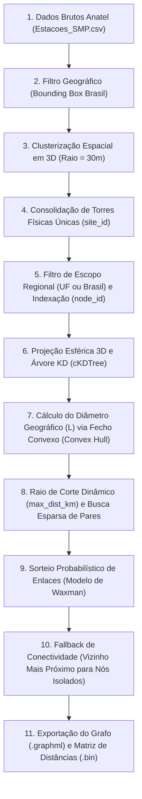

# Metodologia de Geração de Conexões (Topologia de Rede Waxman)

Este documento descreve passo a passo como os dados brutos de estações de telecomunicações (Anatel) são processados, agrupados espacialmente em torres físicas e conectados em um grafo geográfico utilizando o **Modelo Topológico de Waxman** otimizado com indexação espacial tridimensional (`cKDTree`).

---

## Visão Geral do Pipeline



---

## Etapa 1: Limpeza e Clusterização Espacial das Antenas

**Arquivo:** [`src/graph/data_processing.py`](../src/graph/data_processing.py)

Na base original da Anatel (`Estacoes_SMP.csv`), múltiplos registros de antenas (diferentes operadoras, frequências ou tecnologias como 2G, 3G, 4G e 5G) pertencentes a uma **mesma torre física** possuem pequenas divergências de GPS (na casa de poucos metros). Se cada registro fosse tratado como um vértice distinto, o grafo teria milhões de nós redundantes no mesmo local físico.

### 1.1. Filtro de Coordenadas (`load_raw_data`)
Remove registros com erros de cadastro cujas coordenadas caem fora dos limites territoriais do Brasil:
* **Latitude:** $\phi \in [-34{,}0^\circ,\; 5{,}5^\circ]$
* **Longitude:** $\lambda \in [-74{,}5^\circ,\; -32{,}0^\circ]$

### 1.2. Agrupamento por Proximidade em 30 metros (`assign_spatial_clusters`)
Para identificar quais antenas compartilham a mesma estrutura física:
1. Extraem-se os pares únicos de `(Latitude, Longitude)` e convertem-se os ângulos $(\phi, \lambda)$ para radianos.
2. Projetam-se os pontos na superfície da esfera terrestre 3D (com raio médio $R = 6.371\text{ km}$):
   $$
   \begin{aligned}
   x &= R \cos(\phi)\cos(\lambda) \\
   y &= R \cos(\phi)\sin(\lambda) \\
   z &= R \sin(\phi)
   \end{aligned}
   $$
3. Constrói-se uma árvore espacial **`cKDTree`** sobre as coordenadas $(x, y, z)$ e buscam-se todos os pares de pontos a uma distância menor ou igual a **$r = 30\text{ metros}$** ($0{,}03\text{ km}$).
4. Aplica-se o algoritmo de **Componentes Conexos** (`scipy.sparse.csgraph.connected_components`) sobre a matriz de adjacência esparsa desses pares. Cada componente conexo recebe um identificador único de estrutura física (**`site_id`**).

### 1.3. Consolidação por Torre Física (`group_unique_station`)
Agrupam-se os registros pelo `site_id`, consolidando os metadados de cada torre física:
* **`id_local`**: Primeiro número oficial da estação na Anatel (`Número Estação`) para rastreabilidade.
* **`qtd_antenas`**: Total de equipamentos/setores instalados naquela torre.
* **`operadoras`** e **`tecnologias`**: Lista única ordenada das empresas (ex.: `CLARO, TIM, VIVO`) e tecnologias (`GSM, LTE, NR, WCDMA`) presentes na torre.
* **`latitude`** e **`longitude`**: Centroide (média aritmética) das coordenadas do cluster.
* **`municipio`** e **`uf`**: Nome do município e sigla da Unidade Federativa separados a partir do campo `Município-UF`.
* **`tem_2g`, `tem_3g`, `tem_4g`, `tem_5g`**: Flags booleanas indicando as gerações presentes.

> **Resultado no Brasil:** Os ~3,33 milhões de registros de antenas são consolidados em **85.564 torres físicas únicas** (`data/processed/estacoes_unicas.csv`).

---

## Etapa 2: Filtro de Escopo e Indexação Sequencial (`node_id`)

**Arquivo:** [`src/main.py`](../src/main.py)

Quando selecionamos uma região específica (ex.: `--uf MG`, que possui $N = 9.368$ torres) ou o país inteiro (`--uf BR`, com $N = 85.564$ torres):
1. Filtra-se o DataFrame pela coluna `uf`.
2. Reinicia-se o índice e cria-se a coluna **`node_id`** numerada sequencialmente de $0$ até $N - 1$.
3. Isso garante correspondência direta 1-para-1 entre o ID do vértice no grafo (`node_id`), o índice no vetor de demandas (`vetor_demandas.bin`) e a linha/coluna na matriz de distâncias (`distance_matrix.bin`).

---

## Etapa 3: Geração das Conexões pelo Modelo de Waxman

**Arquivo:** [`src/graph/generate_connections.py`](../src/graph/generate_connections.py)

Redes físicas de telecomunicações (enlaces de fibra óptica ou rádio enlace entre torres) não são grafos puramente aleatórios (Erdős–Rényi), pois o custo de cabeamento cresce com a distância física. O **Modelo de Waxman (1988)** modela exatamente esse comportamento: a probabilidade de existir um enlace direto entre duas torres $u$ e $v$ decai exponencialmente com a distância geodésica $d(u, v)$ entre elas:

$$
P(u, v) = \alpha \cdot \exp\left( -\frac{d(u, v)}{\beta \cdot L} \right)
$$

Onde:
* $d(u, v)$: Distância geodésica (em km) na superfície da Terra entre as torres $u$ e $v$.
* $L$: Diâmetro geográfico máximo da região analisada (maior distância entre duas torres do conjunto, em km).
* $\alpha \in (0, 1]$: Controla a **densidade geral** de conexões a curtas distâncias (padrão: $\alpha = 0{,}4$).
* $\beta \in (0, 1]$: Controla o **alcance característico** dos enlaces em relação ao diâmetro $L$. O produto $\beta \cdot L$ é a distância de decaimento característica (distância na qual a probabilidade cai para $\alpha / e \approx 0{,}368\alpha$).

---

### Passo 3.1: Projeção Cartesiana 3D e Construção da `cKDTree`
Calcular a matriz completa de distâncias entre todos os pares exige complexidade $O(N^2)$, o que para o Brasil ($N = 85.564$) representaria $\approx 7{,}3 \times 10^9$ pares ($\approx 58\text{ GB}$ apenas para uma matriz de floats).

Para contornar o custo $O(N^2)$:
1. Projetam-se todas as $N$ torres em coordenadas cartesianas 3D $(x, y, z)$ na esfera de raio $R = 6.371\text{ km}$ (`_latlon_to_cartesian_3d`).
2. Indexam-se os pontos em uma árvore espacial **`scipy.spatial.cKDTree`**.
3. A conversão entre a distância euclidiana da corda tridimensional ($d_{\text{corda}}$) e a distância geodésica exata sobre a curvatura da Terra ($d_{\text{km}}$, equivalente à fórmula de Haversine) é dada analiticamente por (`_chord_to_haversine_km`):
   $$
   d_{\text{km}} = 2 R \arcsin\left( \frac{d_{\text{corda}}}{2 R} \right)
   $$

---

### Passo 3.2: Cálculo Rápido do Diâmetro Geográfico $L$ via Fecho Convexo (`calculate_max_diameter_km`)
Em vez de comparar todos os $\binom{N}{2}$ pares de pontos para descobrir a distância máxima $L$:
1. Calcula-se o **Fecho Convexo 2D** (`scipy.spatial.ConvexHull`) das coordenadas `(longitude, latitude)`.
2. Como o par de pontos mais distantes entre si obrigatoriamente pertence à fronteira do fecho convexo (que contém apenas algumas dezenas de vértices na borda do estado/país), calcula-se a distância apenas entre os vértices do fecho convexo.
3. Obtém-se $L$ exato em menos de **5 milissegundos** (ex.: $L \approx 1.239{,}06\text{ km}$ para MG; $L \approx 4.499{,}36\text{ km}$ para o Brasil).

---

### Passo 3.3: Raio de Corte Dinâmico (`max_dist_km`)

#### 1. O Problema: Por que precisamos de um raio máximo de busca?
No modelo de Waxman original, a probabilidade de conexão entre duas torres $u$ e $v$ separadas por uma distância $d$ é:
$$
P(d) = \alpha \cdot \exp\left(-\frac{d}{\beta \cdot L}\right)
$$
Matematicamente, a função exponencial $\exp(-x)$ **nunca chega exatamente a zero** para nenhuma distância finita $d$. Se seguíssemos a fórmula ao pé da letra, teríamos que testar todos os $\binom{N}{2}$ pares de torres (por exemplo, uma torre no Chuí-RS com outra em Boa Vista-RR), mesmo quando a chance de conexão entre elas é de $0{,}00000001\%$.

Por outro lado, se escolhêssemos um raio máximo **fixo** no código (ex.: `max_dist_km = 15 km`), surgiria outro problema:
* Se você mudasse $\beta$ ou mudasse a escala geográfica $L$ (por exemplo, de uma cidade pequena para o estado de Minas Gerais inteiro), um corte fixo de $15\text{ km}$ amputaria conexões legítimas que ainda tinham alta probabilidade de acontecer, ou buscaria longe demais sem necessidade.

#### 2. A Ideia do Corte Dinâmico: Fixar o "Erro Residual" ($\epsilon$), não os Quilômetros
Em vez de fixar uma distância arbitrária em quilômetros, fixamos uma **fração mínima aceitável da probabilidade inicial**, chamada `min_prob_ratio` ($\epsilon$).

* Na distância $d = 0$, a probabilidade máxima possível do modelo é $P(0) = \alpha$.
* À medida que a distância $d$ cresce, a probabilidade cai segundo o fator de decaimento exponencial:
  $$
  \frac{P(d)}{P(0)} = \exp\left(-\frac{d}{\beta \cdot L}\right)
  $$
* Definimos o limiar $\epsilon = \text{min\_prob\_ratio} = 0{,}0025$ (ou seja, **$0{,}25\%$** da probabilidade máxima $\alpha$). Isso significa: *"Quando a distância $d$ for tão grande que o fator exponencial já caiu para menos de $0{,}25\%$ do valor inicial (ou seja, $99{,}75\%$ do decaimento já ocorreu), podemos parar de buscar vizinhos além dessa distância"*.

#### 3. Dedução Passo a Passo da Fórmula no Código
Queremos encontrar exatamente qual é a distância $d_{\max}$ (`max_dist_km`) onde o fator exponencial atinge o limiar $\epsilon$:

1. Igualamos o decaimento ao limiar $\epsilon$:
   $$
   \exp\left(-\frac{d_{\max}}{\beta \cdot L}\right) = \epsilon
   $$
2. Aplicamos o logaritmo natural ($\ln$) dos dois lados para isolar $d_{\max}$:
   $$
   -\frac{d_{\max}}{\beta \cdot L} = \ln(\epsilon)
   $$
3. Multiplicamos por $-1$ e passamos $(\beta \cdot L)$ multiplicando:
   $$
   d_{\max} = \underbrace{-\ln(\epsilon)}_{k} \cdot (\beta \cdot L)
   $$

É exatamente isso que as linhas 115–117 de [`generate_connections.py`](../src/graph/generate_connections.py#L115-L117) calculam:
```python
k = -np.log(min_prob_ratio)      # Para min_prob_ratio = 0.0025, k = -ln(0.0025) ≈ 5.9915
max_dist_km = float(k * (beta * L))
```

#### 4. O que significa o fator $k \approx 6$?
Na física e na engenharia, o termo $\tau = \beta \cdot L$ é chamado de **comprimento característico de decaimento** (o equivalente espacial da constante de tempo $\tau$ na descarga de um capacitor):
* Em $d = 1 \cdot (\beta L)$, a probabilidade cai para $e^{-1} \approx 36{,}8\%$ de $\alpha$.
* Em $d = 3 \cdot (\beta L)$, a probabilidade cai para $e^{-3} \approx 4{,}98\%$ de $\alpha$.
* Em $d = 6 \cdot (\beta L)$, a probabilidade cai para $e^{-6} \approx 0{,}25\%$ de $\alpha$ ($P(d_{\max}) = 0{,}4 \times 0{,}0025 = 0{,}001$, ou seja, apenas $0{,}1\%$ de chance de existir aresta).

Assim, `max_dist_km` se adapta **automaticamente** a qualquer região ($L$) e a qualquer parâmetro $\beta$:

| Escopo | Diâmetro $L$ calculado | Parâmetro $\beta$ | Alcance Característico ($\beta \cdot L$) | Raio Dinâmico ($d_{\max} = 5{,}991 \cdot \beta L$) | Chance de aresta na borda do raio |
| :--- | :---: | :---: | :---: | :---: | :---: |
| **Minas Gerais (`MG`)** | $1.239{,}06\text{ km}$ | $0{,}015$ | $18{,}59\text{ km}$ | **$111{,}36\text{ km}$** | $0{,}1\%$ ($0{,}0025\alpha$) |
| **Brasil (`BR`)** | $4.499{,}36\text{ km}$ | $0{,}0003$ | $1{,}35\text{ km}$ | **$8{,}09\text{ km}$** | $0{,}1\%$ ($0{,}0025\alpha$) |

---

### Passo 3.4: Busca Esparsa e Sorteio de Monte Carlo (Vetorizado)
1. A árvore `tree.query_pairs(r=max_dist_km)` retorna **apenas os pares de torres candidatos** cuja distância está dentro do raio $d_{\max}$.
2. Calcula-se a distância geodésica exata $d_{\text{km}}$ apenas para esses pares candidatos.
3. Calcula-se o vetor de probabilidades de Waxman:
   ```python
   probs = alpha * np.exp(-d_km / (beta * L))
   ```
4. Realiza-se o sorteio de Bernoulli vetorizado (`np.random.rand(len(d_km)) < probs`) com semente fixa (`seed=42`) para garantir total reprodutibilidade científica.
5. Os pares sorteados são adicionados ao grafo NetworkX com os atributos:
   * `weight`: distância geodésica em km (`float`)
   * `distance_km`: distância geodésica em km (`float`)
   * `tipo`: `"waxman"`

---

### Passo 3.5: Mecanismo de Fallback para Torres Isoladas
Como o modelo de Waxman é probabilístico, torres rurais ou muito afastadas de centros urbanos podem acabar com **grau zero** ($deg(u) = 0$) após o sorteio, caso não tenham vizinhas próximas ou não sejam sorteadas.

Para evitar vértices completamente isolados:
1. Identificam-se todos os nós com grau zero no grafo (`G.degree(u) == 0`).
2. Para todas as torres isoladas, consulta-se a `cKDTree` buscando a **vizinha física mais próxima** (`tree.query(..., k=2)`, já que `k=1` é o próprio nó).
3. Cria-se uma aresta conectando a torre isolada à sua vizinha mais próxima com o atributo `tipo = "fallback_mais_proxima"` (plotada em vermelho tracejado nos mapas de visualização).

---

## Etapa 4: Estrutura Final do Grafo Exportado

Ao final do processo, o grafo `G` é salvo em formato **GraphML** (`data/processed/grafo_<uf>.graphml`) contendo:

### Atributos dos Vértices (`nodes`)
| Atributo | Tipo | Descrição |
| :--- | :--- | :--- |
| `id` (`node_id`) | `int` | Índice sequencial do vértice ($0 \dots N-1$) |
| `latitude` | `float` | Latitude decimal da torre física |
| `longitude` | `float` | Longitude decimal da torre física |
| `id_local` | `int` | Código da estação na Anatel (`Número Estação`) |
| `operadoras` | `str` | Operadoras presentes na torre (ex.: `"CLARO, TIM, VIVO"`) |
| `tecnologias` | `str` | Tecnologias instaladas (ex.: `"GSM, LTE, NR, WCDMA"`) |
| `qtd_antenas` | `int` | Quantidade total de antenas agrupadas na torre |
| `tem_5g` | `bool` | Indica se a torre já possui tecnologia 5G (`NR`) |

### Atributos das Arestas (`edges`)
| Atributo | Tipo | Descrição |
| :--- | :--- | :--- |
| `weight` | `float` | Distância física geodésica entre as duas torres (em km) |
| `distance_km` | `float` | Distância física geodésica entre as duas torres (em km) |
| `tipo` | `str` | `"waxman"` (sorteio probabilístico) ou `"fallback_mais_proxima"` (conexão de emergência) |
